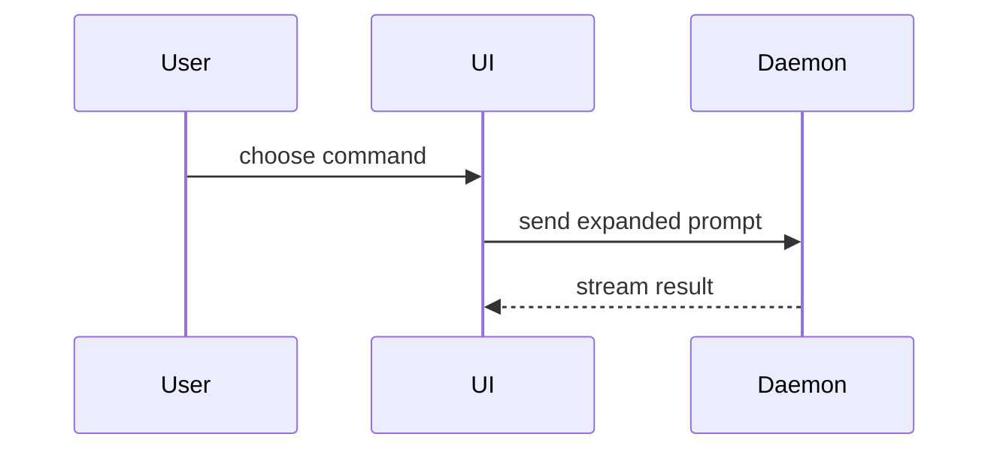

Use this template for the body. If the repository has its own PR or MR template,
fill that one instead and keep its required sections and checklists; mark an item
complete only when its requirement has been met.

```markdown
## Summary

<one or two sentences: what changes for whom>

<diagram, diff-sketch, tree or table>

- <distinct change>

## Evidence

- **Before:** <screenshot / recording / output / failing test>
  **After:** <screenshot / recording / output / passing test>

## Merge Danger

**Door:** <one-way or two-way>

<optional: why>

**Blast Radius:** <one word>

<optional: who or what could break>
```

Skip preambles and keep prose brief. Use the repository's domain language. Write
for a reviewer who has not read the conversation, and describe the current head,
not how the PR got there: no "now also", "updated" or "fixed review" narration.

Add a section only for required migrations or production cutover steps, and put it
before Merge Danger. Leave implementation walkthroughs, test-command lists, test
counts, file inventories and generic caveats out.

## Summary

Pick the smallest view that makes the key point clear. Use one, sometimes two; rarely more.

- Logic or an algorithm as pseudocode:

```text
on(save)
  if content is unchanged
    return cached result
  write new content
  return fresh result
```

- Runtime control flow as a call tree:

```text
submitForm
  createSession
    persistPrompt
    launchAgent
  navigateToSession
```

- UI structure as a component tree, with the state and module boundaries that matter:

```text
<SessionPage> (apps/example/src/routes/session.tsx)
  useSessionEvents()
  <SessionToolbar>
    <RunSkillButton> (packages/ui)
```

- File responsibility or a broad refactor as a shallow file tree:

```text
src/
├── commands/       # parses user actions
├── sessions/       # owns session state
└── transport/      # sends API requests
```

- Interaction, control flow or data flow between components with Mermaid:



- A changed behavior or contract as a before/after table:

| Request | Before | After |
| --- | --- | --- |
| Unknown token | body buffered, then `404` | `404`, body not read |

- `diff` when the point is what changes and the surrounding shape already exists.
  Match the diff shape to the topic: component tree, file layout, call tree or state.

```diff
 on(save)
-  write content
+  if content is unchanged
+    return cached result
+  write new content
+  invalidate cache
```

Place each view next to the short text it supports. Keep only the calls, files,
props, states and boundaries needed to make the point.

## Evidence

Show that the change works on its real input, before and after on the same data.
This applies to backend, API, CLI and infrastructure changes too.

- **Screenshots** prove states and outcomes. Any visible change gets before and after screenshots.
- **Recordings** prove sequences. When the change is an interaction, a flow across
  pages, streaming, timing or anything a still image cannot show, add a proof
  video. Read the [video reference](../environment/references/video.md) to delegate
  the capture and check it.
- **Execution** backs up captures and is the evidence when nothing is visible:
  requests and responses, terminal output, traces. For a test, show in pseudocode
  what it checks and how it failed before the fix.

An HTML mock or animation of intended behavior does not prove the implementation
works. If a capture is impossible, say so in one line and show the strongest real
evidence.

Upload each capture through the host's attachment flow and embed it under its
Before/After line. On GitHub, keep an uploaded video URL alone in its paragraph
so it renders as a player.

## Merge Danger

**Door:** you can walk back through a two-way door, but not through a one-way door.
A change that is cheap to revert is two-way. Data migrations, deletions, changed
public contracts or persisted formats, published packages, external side effects
and other hard-to-reverse changes are one-way; say what cannot be undone.

**Blast Radius:** the scope of what this change could affect, in one word (`narrow`,
`navigation`, `auth`, `deploys`, `billing`…). Then list the realistic ramifications:
layout shift, consumers that break, mobile, permissions, existing data, bookmarks.
Write manual steps needed before or after merge as a numbered list.

## Publish

Use the current branch's reviewed, verified commits and the intended target branch.
Read the branch's push remote to select the host and repository; use `environment`
for access. For self-hosted GitLab, explicitly target that host and repository.
Push the branch and create the PR with `gh` on GitHub or the MR with `glab` on GitLab;
update an existing request for this branch instead of opening a duplicate. Pass the
description through a body file or the host's equivalent so Markdown stays literal.
Keep the title and body accurate after pushes that change their claims.

Register the request with the thread's PR-linking tool when available. Read back
the published title and description through the host CLI/API, and open the page
when it embeds images or videos to check that they render. Return the request URL.
